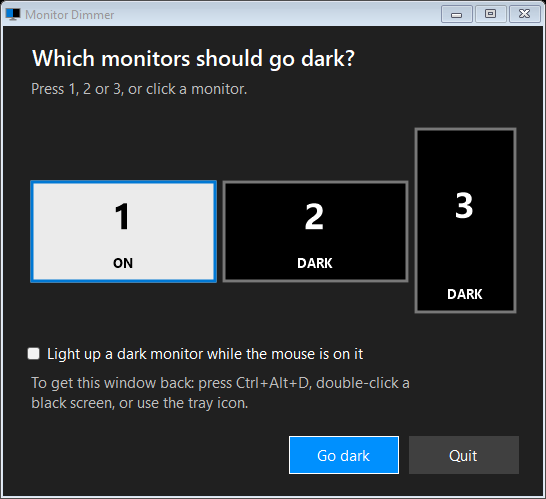

<div align="center">

# Monitor Dimmer

### Three monitors. One job. Black out the rest.

Your second screen has Discord, your third has a video, and neither is helping.<br>
Monitor Dimmer turns the screens you aren't using black, so your eyes stay on the one that matters.

**[Download MonitorDimmer.exe](../../releases/latest/download/MonitorDimmer.exe)**

Free · Windows · about 25 KB · nothing to install


*Follow-the-mouse mode: the screen you're on stays lit, and the others go black.*

</div>

## Start in 10 seconds

1. **Open** `MonitorDimmer.exe`. A big number appears on each monitor, so you can see which is which.
2. **Press 1, 2 or 3** (or click a monitor) to set it to DARK or ON.
3. **Press Enter.** That's it.

<div align="center">

</div>

## Two ways to focus

| Mode | What it does | Good for |
|---|---|---|
| **Stay dark** | The monitors you choose stay black until you bring them back. | Deep work, or watching a film on one screen |
| **Follow the mouse** | Dark monitors light up only while your mouse is on them. | Focusing without losing your other screens |

Tick **"Light up a dark monitor while the mouse is on it"** for follow mode. If you set *every* monitor to DARK, follow mode turns on by itself, so the one you're using always stays lit.

## Getting your screens back

You can't get stuck on a black screen. Any of these works:

| Do this | What happens |
|---|---|
| Press **Ctrl+Alt+D** | The chooser comes back and all screens light up |
| **Double-click** a black screen | Same |
| Open the program again | Same |
| Use the **tray icon** near the clock | Right-click to choose monitors or quit |
| Click **Quit** or press **Esc** in the chooser | Everything returns to normal and the program closes |

## Why it's nice to use

- **It keeps out of your way.** The black screens never take keyboard focus from the app you're using.
- **It finds your monitors for you.** Any number and any layout, including portrait screens. Numbers run left to right, and plugging in or unplugging a monitor is picked up automatically.
- **It's tiny and leaves things alone.** One small file with no installer, no account and no admin rights. It has no network code and changes no display settings.
- **It's easy to check.** All the code is one C# file in this repo.

## Good to know

- **Windows may warn you the first time.** The exe isn't code-signed, so SmartScreen can show "Windows protected your PC". Click **More info**, then **Run anyway**. Or build it yourself from source using the steps below.
- **The monitors stay on.** The program covers each screen with a black window. It doesn't put them to sleep, so an LCD's backlight keeps running. OLED pixels really do go dark.
- **Games:** borderless fullscreen should work best. Exclusive fullscreen games may not get along with the black windows.
- **Tested on:** Windows 11 with three monitors. It targets Windows 10 and 11, but hasn't been tried on Windows 10 yet.

## Build it yourself

You only need Windows, because the C# compiler comes with it. From a folder containing this repo:

```bash
powershell -ExecutionPolicy Bypass -File build.ps1 -Out MonitorDimmer.exe
```

The code is in [`MonitorDimmer.cs`](MonitorDimmer.cs), and [`build.ps1`](build.ps1) draws the icon and compiles it.
